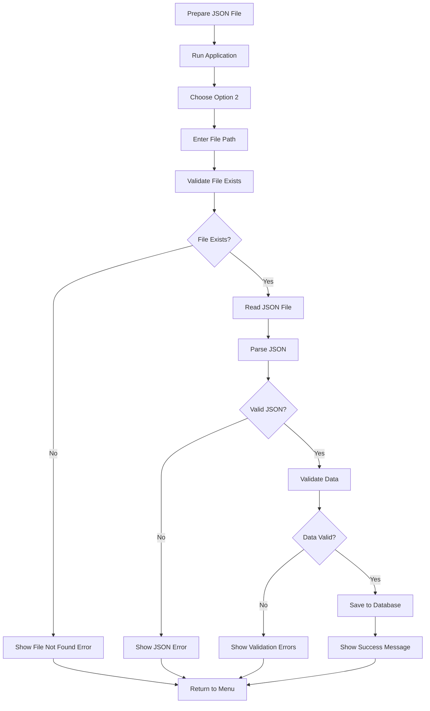

# Portfolio Rebalancer

A comprehensive F# application for portfolio rebalancing with support for index-based and current portfolio rebalancing strategies. Built with functional programming principles and modern .NET technologies.

## ⚡ Quick Start

**Want to get running immediately?** Follow these steps:

1. **Start Database:**
   ```bash
   docker run --name portfolio-postgres -e POSTGRES_USER=postgres -e POSTGRES_PASSWORD=postgres1234 -e POSTGRES_DB=portfolio -p 5432:5432 -d postgres
   ```

2. **Build & Run:**
   ```bash
   dotnet build
   dotnet run --project PortfolioRebalancer/
   ```

3. **Get Data & Start:**
   - Choose `Option 5` to fetch market data
   - Choose `Option 1` to view current data
   - Choose `Option 3` or `Option 4` to rebalance

**For detailed instructions, see [Running the Application](#-running-the-application) below.**

## 🚀 Features

- **📊 Index Rebalancing**: Rebalance a portfolio based on index weights
- **🔄 Current Portfolio Rebalancing**: Rebalance existing portfolio with cash injection
- **💰 Commission Calculation**: Support for realistic trading commission calculations
- **🌐 Data Scraping**: Automated data collection from financial websites
- **🗄️ Database Storage**: PostgreSQL-based data persistence
- **⚡ Performance Monitoring**: Built-in performance tracking and caching
- **📝 Comprehensive Logging**: Detailed logging for debugging and monitoring
- **🛡️ Type Safety**: Full F# type safety with discriminated unions and Result types
- **🧪 Comprehensive Testing**: 35 unit tests covering validation, business logic, and utilities
- **⚙️ Configuration Management**: Centralized application settings
- **🔍 Input Validation**: Robust validation with custom error types

## 🏗️ Architecture

The application follows functional programming principles with clear separation of concerns:

### Core Modules

**Types.fs** - Domain types and data structures
- Discriminated unions, Result types, domain models

**Configuration.fs** - Application settings and constants  
- Environment-aware settings, centralized configuration

**Validation.fs** - Input validation and error handling
- Custom validation rules, Result-based error handling

**RebalancingCalculations.fs** - Pure calculation logic
- Immutable calculations, functional algorithms

**Rebalancer.fs** - Orchestration and business logic
- Result handling, error propagation

**Table.fs** - Display and presentation logic
- Rich console output, formatted tables

**Db.fs** - Database operations
- Async operations, connection management

**Scraper.fs** - Web scraping functionality
- Selenium integration, data extraction

**Helpers.fs** - Utility functions
- Common operations, formatting helpers

**Logging.fs** - Logging infrastructure
- File-based logging, different log levels

**Performance.fs** - Performance monitoring and caching
- In-memory caching, metrics collection

**Extensions.fs** - Extension methods and utilities
- Type extensions, utility functions

**Messages.fs** - User-friendly messages
- Centralized messaging, localization support

### Key Design Principles

1. **🔄 Immutability**: All data transformations are immutable
2. **🧪 Pure Functions**: Business logic separated from side effects
3. **🛡️ Type Safety**: Compile-time guarantees with discriminated unions
4. **⚠️ Error Handling**: Result types for explicit error handling
5. **⚙️ Configuration**: Centralized configuration management
6. **⚡ Performance**: Built-in caching and performance monitoring
7. **📝 Logging**: Comprehensive logging for debugging and monitoring

## 🚀 Getting Started

### Prerequisites

- **.NET 9.0 SDK** - [Download here](https://dotnet.microsoft.com/download/dotnet/9.0)
- **PostgreSQL database** (or Docker for containerized setup)
- **Chrome browser** (for web scraping functionality)

### Database Setup

#### Option 1: Docker (Recommended for Development)

Run PostgreSQL in a Docker container:

```bash
docker run --name portfolio-postgres \
  -e POSTGRES_USER=postgres \
  -e POSTGRES_PASSWORD=postgres1234 \
  -e POSTGRES_DB=portfolio \
  -p 5432:5432 \
  -d postgres
```

**Docker Management Commands:**
```bash
# Start the database
docker start portfolio-postgres

# Stop the database
docker stop portfolio-postgres

# Remove the container
docker rm portfolio-postgres

# View logs
docker logs portfolio-postgres

# Connect to database
docker exec -it portfolio-postgres psql -U postgres -d portfolio

# Check container status
docker ps -a | grep portfolio-postgres
```

#### Option 2: Local PostgreSQL Installation

1. Install PostgreSQL on your system
2. Create a database named `portfolio`
3. Update connection string in `Configuration.fs` if needed

### Installation & Setup

1. **Clone the repository:**
   ```bash
   git clone <repository-url>
   cd PortfolioRebalancer
   ```

2. **Build the solution:**
   ```bash
   dotnet build
   ```

3. **Run the application:**
   ```bash
   # From solution root (recommended)
   dotnet run --project PortfolioRebalancer/
   
   # Or navigate to project directory
   cd PortfolioRebalancer/
   dotnet run
   ```

**Note:** This is a multi-project solution. The main application is in the `PortfolioRebalancer/` subdirectory, so you need to specify the project when running from the solution root.

## 🏃‍♂️ Running the Application

### Step-by-Step Guide

#### 1. **Start the Database**
First, ensure your PostgreSQL database is running:

```bash
# If using Docker (recommended)
docker start portfolio-postgres

# Verify database is running
docker ps | grep portfolio-postgres
```

#### 2. **Build the Application**
```bash
# Clean build (recommended for first run)
dotnet clean
dotnet build

# Or just build
dotnet build
```

#### 3. **Run the Application**
```bash
# Run from project root (specify the project)
dotnet run --project PortfolioRebalancer/

# Or navigate to the project directory first
cd PortfolioRebalancer/
dotnet run

# Or run from solution root with explicit project
dotnet run --project PortfolioRebalancer/PortfolioRebalancer.fsproj
```

#### 4. **Using the Application Menu**
Once the application starts, you'll see an interactive menu:

```
┌─────────────────────────────────────────────────────────┐
│                    Portfolio Rebalancer                 │
├─────────────────────────────────────────────────────────┤
│ Option │ Description                                    │
├────────┼────────────────────────────────────────────────┤
│ 1      │ Show Index and Current Portfolio              │
│ 2      │ Import Current Portfolio from JSON            │
│ 3      │ Rebalance Index with Cash                     │
│ 4      │ Rebalance Current Portfolio with Cash         │
│ 5      │ Get Index and Stock Data                      │
│ 6      │ Show Performance Metrics                      │
│ 7      │ Clear Cache                                   │
│ 0      │ Exit                                          │
└─────────────────────────────────────────────────────────┘
```

### Typical Workflow

1. **First Time Setup:**
   ```
   Option 5 → Get Index and Stock Data
   ```
   This scrapes current market data and stores it in the database.

2. **Import Portfolio (Optional):**
   ```
   Option 2 → Import Current Portfolio from JSON
   ```
   Import your current portfolio from a JSON file.

3. **View Current Data:**
   ```
   Option 1 → Show Index and Current Portfolio
   ```
   Review the current index and portfolio data.

4. **Perform Rebalancing:**
   ```
   Option 3 → Rebalance Index with Cash
   Option 4 → Rebalance Current Portfolio with Cash
   ```
   Choose based on your needs.

### Common Commands

```bash
# Development workflow
dotnet clean && dotnet build && dotnet run --project PortfolioRebalancer/

# Run with specific configuration
dotnet run --project PortfolioRebalancer/ --configuration Release

# Run with environment variables
$env:DATABASE_URL="your-connection-string"; dotnet run --project PortfolioRebalancer/

# Check application version
dotnet run --project PortfolioRebalancer/ -- --version

# Run tests before starting
dotnet test && dotnet run --project PortfolioRebalancer/
```

### Troubleshooting

#### Database Connection Issues
```bash
# Check if database is running
docker ps | grep portfolio-postgres

# Check database logs
docker logs portfolio-postgres

# Test database connection
docker exec -it portfolio-postgres psql -U postgres -d portfolio -c "SELECT 1;"

# Restart database if needed
docker restart portfolio-postgres
```

#### Build Issues
```bash
# Clean and rebuild
dotnet clean
dotnet restore
dotnet build

# Check for missing dependencies
dotnet list package

# Update packages if needed
dotnet add package PackageName
```

#### Runtime Issues
```bash
# Check application logs
# Logs are written to the application directory

# Run with verbose output
dotnet run --project PortfolioRebalancer/ --verbosity detailed

# Check .NET version
dotnet --version

# Verify all prerequisites
dotnet --info
```

#### Chrome/Selenium Issues
```bash
# Ensure Chrome is installed
# The application will download ChromeDriver automatically

# If ChromeDriver issues occur:
# 1. Update Chrome browser
# 2. Clear application cache (Option 7)
# 3. Restart the application
```

### Performance Tips

1. **Use Caching:** The application automatically caches database queries
2. **Clear Cache:** Use Option 7 to clear cache if data seems stale
3. **Monitor Performance:** Use Option 6 to view performance metrics
4. **Database Optimization:** Ensure PostgreSQL has adequate memory

## 📥 Portfolio Import Documentation

### Overview

The Portfolio Rebalancer supports importing current portfolio data from JSON files. This allows you to work with your actual portfolio holdings for rebalancing calculations.

> 📖 **For detailed import instructions, see [IMPORT_GUIDE.md](IMPORT_GUIDE.md)**

### Important Notes

- **ETF Filtering**: The importer automatically excludes ETFs from your portfolio
- **Supported Securities**: Only individual stocks are imported (no ETFs, bonds, or other securities)
- **File Format**: JSON format with specific structure requirements

### Import Process

#### 1. **Prepare Your Portfolio Data**

Create a JSON file with your current portfolio holdings. The file should be named `CurrentPortfolio.json` and placed in the application's working directory.

#### 2. **JSON Format**

Your portfolio JSON file must follow this exact structure:

```json
[
    {
        "Symbol": "BAHL",
        "Shares": 650,
        "Price": 157.85
    },
    {
        "Symbol": "DCR", 
        "Shares": 3518,
        "Price": 26.33
    },
    {
        "Symbol": "MEBL",
        "Shares": 500,
        "Price": 309.89
    }
]
```

#### 3. **Data Fields**

**Symbol** (string)
- Stock symbol/ticker
- Example: `"BAHL"`, `"DCR"`

**Shares** (integer)  
- Number of shares owned
- Example: `650`, `3518`

**Price** (decimal)
- Current price per share
- Example: `157.85`, `26.33`

#### 4. **Import Steps**

1. **Prepare your JSON file:**
   - Create your portfolio JSON file in the required format
   - Place it anywhere on your system (you'll provide the path)

2. **Run the application:**
   ```bash
   dotnet run --project PortfolioRebalancer/
   ```

3. **Import the portfolio:**
   - Choose `Option 2` from the menu
   - Enter the full path to your JSON file when prompted
   - The application will read, validate, and import your data
   - Success message will confirm import with details

4. **Verify the import:**
   - Choose `Option 1` to view your imported portfolio
   - Review the data for accuracy

### Sample Data

The application includes sample data in the `Portfolio Data/` directory:

- `CurrentPortfolio.json` - Sample portfolio for testing
- `periodic-details.pdf` - Documentation

#### Using Sample Data

```bash
# Copy sample portfolio to working directory
cp "Portfolio Data/CurrentPortfolio.json" .

# Run application and import
dotnet run --project PortfolioRebalancer/
# Choose Option 2 to import
```

### Import Validation

The import process includes several validation checks:

- **JSON Format**: Validates proper JSON structure
- **Data Types**: Ensures correct data types for each field
- **Required Fields**: Verifies all required fields are present
- **Database Storage**: Saves validated data to PostgreSQL database

### Error Handling

Common import errors and solutions:

#### **File Not Found**
```
[ERROR] File not found: C:\path\to\your\file.json
Please ensure the file exists and the path is correct.
```
**Solution:** Check the file path and ensure the file exists at the specified location

#### **Invalid File Path**
```
[ERROR] Directory not found: C:\nonexistent\path\file.json
Please check the file path and ensure the directory exists.
```
**Solution:** Verify the directory path exists and is accessible

#### **Invalid JSON Format**
```
[ERROR] Invalid JSON format: Unexpected character at position 15
Please check the JSON syntax and structure.
```
**Solution:** Validate JSON syntax using online tools and check for syntax errors

#### **Missing Fields**
```
[ERROR] Could not parse current portfolio JSON.
Please check the JSON format and ensure it matches the required structure.
```
**Solution:** Ensure all records have `Symbol`, `Shares`, and `Price` fields with correct names

#### **Validation Errors**
```
[ERROR] Validation errors found:
  - Record 1: Symbol is empty or null
  - Record 3: Shares must be greater than 0 (got 0)
  - Record 5: Price must be greater than 0 (got 0)
```
**Solution:** Fix the validation errors shown in the error message

#### **Invalid Data Types**
```
[ERROR] Validation errors found:
  - Record 2: Shares must be greater than 0 (got -5)
  - Record 4: Price must be greater than 0 (got 0)
```
**Solution:** Ensure `Shares` is a positive integer and `Price` is a positive decimal number

### Import Workflow



### Best Practices

1. **Data Accuracy**: Ensure your share counts and prices are current
2. **Symbol Consistency**: Use the same symbols as your index data
3. **File Path**: Use full absolute paths or relative paths from the application directory
4. **Backup**: Keep a backup of your original portfolio data
5. **Validation**: Always verify imported data using Option 1
6. **File Permissions**: Ensure the application has read access to your portfolio file

### Advanced Usage

#### **Multiple Portfolio Files**

You can work with different portfolios by providing different file paths:

```bash
# Import different portfolios
# When prompted, enter the path to each portfolio file
# Example paths:
# C:\Portfolios\portfolio-a.json
# C:\Portfolios\portfolio-b.json
# ./data/my-portfolio.json
```

#### **Automated Import**

For automated workflows, you can script the import process:

```bash
#!/bin/bash
# Automated portfolio import script
PORTFOLIO_FILE="$1"
echo "Importing portfolio from: $PORTFOLIO_FILE"
# Note: This would require the application to support non-interactive mode
# For now, manual import is required
```

### Troubleshooting Import Issues

#### **File Path Issues**
- **Problem**: File not found errors
- **Solution**: Use absolute paths or relative paths from the application directory
- **Example**: `C:\Users\YourName\Documents\portfolio.json` or `./data/portfolio.json`

#### **Permission Issues**
- **Problem**: Cannot read file
- **Solution**: Check file permissions and ensure read access
- **Windows**: Right-click file → Properties → Security → Edit permissions
- **Linux/Mac**: Use `chmod 644 filename.json` to set read permissions

#### **Database Issues**
- **Problem**: Import succeeds but data not saved
- **Solution**: Check database connection and table structure

#### **Data Validation Issues**
- **Problem**: Valid JSON but import fails
- **Solution**: Check data types and field names match exactly

### Integration with Rebalancing

After importing your portfolio:

1. **Get Market Data**: Use Option 5 to fetch current prices
2. **View Portfolio**: Use Option 1 to verify your holdings
3. **Rebalance**: Use Option 4 for current portfolio rebalancing
4. **Compare**: Use Option 3 for index-based rebalancing comparison

The imported portfolio data is automatically used in all rebalancing calculations and will be cached for performance.

## 🧪 Testing

The project includes a comprehensive test suite with **35 tests** covering all major functionality, featuring beautiful enhanced output using Spectre.Console:

### Test Coverage

**Validation** (15 tests)
- Input validation, error handling, and data integrity

**Helper Functions** (5 tests)  
- Utility functions and calculations

**Rebalancing Calculations** (8 tests)
- Core rebalancing logic and edge cases

**Configuration** (3 tests)
- Application settings and constants

**Messages** (2 tests)
- User-facing messages and formatting

**Total: 35 tests** covering all critical business logic and edge cases.

### 🧪 Testing

The test suite provides comprehensive coverage of all critical functionality:

```bash
# Run all tests
dotnet test

# Run tests with detailed output
dotnet test --verbosity detailed

# Run specific test project
dotnet test PortfolioRebalancer.Tests/

# Run tests with normal verbosity
dotnet test --verbosity normal
```


### Test Categories

The test suite includes:
- **Unit Tests**: Individual function testing with comprehensive coverage
- **Validation Tests**: Input validation and error handling scenarios
- **Business Logic Tests**: Core rebalancing calculations and edge cases
- **Configuration Tests**: Application settings and constants validation
- **Extension Tests**: Type extensions and utility function testing

## 💻 Usage Examples

### Index Rebalancing

```fsharp
let config = {
    IncludeCommission = true
    Cash = 10000m
    Index = indexData
    Current = []
    Prices = priceData
}

let result = rebalanceIndex config
```

### Current Portfolio Rebalancing

```fsharp
let config = {
    IncludeCommission = true
    Cash = 5000m
    Index = indexData
    Current = currentPortfolio
    Prices = priceData
}

let result = rebalanceCurrentPortfolio config
```

### Application Menu

The application provides an interactive menu with the following options:

1. **Show Index and Current Portfolio** - Display current portfolio data
2. **Import Current Portfolio from JSON** - Import portfolio data from JSON file
3. **Rebalance Index with Cash** - Perform index-based rebalancing
4. **Rebalance Current Portfolio with Cash** - Rebalance existing portfolio
5. **Get Index and Stock Data** - Scrape and save market data
6. **Show Performance Metrics** - Display performance statistics
7. **Clear Cache** - Clear cached data and metrics
0. **Exit** - Exit the application

## ⚙️ Configuration

Key configuration options in `Configuration.fs`:

### Commission Settings
- **Fixed Rate**: Commission per share for low-priced stocks
- **Percentage Rate**: Percentage-based commission for high-priced stocks

### Database Settings
- **Connection Strings**: Environment-aware database connections
- **Timeouts**: Database operation timeouts
- **Retry Logic**: Automatic retry for failed operations

### Validation Rules
- **Cash Amount Limits**: Minimum and maximum cash amounts
- **Symbol Length**: Valid symbol length constraints
- **Price Ranges**: Valid price ranges for stocks

### Application Settings
- **Culture**: Localization settings (PKR currency)
- **Logging**: Log levels and file paths
- **Performance**: Cache settings and metrics retention

### Database Configuration

The application automatically detects the environment and uses appropriate database settings:

- **Development**: Uses local PostgreSQL connection
- **Production**: Uses `DATABASE_URL` environment variable
- **Docker**: Uses default PostgreSQL connection string

## ⚡ Performance Features

- **💾 Caching**: In-memory caching for frequently accessed data
- **📊 Performance Monitoring**: Built-in metrics collection
- **🔄 Async Operations**: Non-blocking database and web operations
- **🧹 Memory Management**: Proper resource disposal and cleanup
- **📈 Metrics Collection**: Operation timing and success tracking

## ⚠️ Error Handling

The application uses F# Result types for explicit error handling:

```fsharp
type ValidationError =
    | InvalidCashAmount of decimal
    | InvalidSymbol of string
    | MissingPriceData of string list
    | EmptyIndex
    | EmptyPortfolio
    | InsufficientData of string

type ScrapingError =
    | NavigationError of string
    | ElementNotFound of string
    | DataExtractionError of string
    | TimeoutError of string
    | NetworkError of string
```

## 📝 Logging

Comprehensive logging with different levels:
- **Debug**: Detailed operation information
- **Info**: General application flow
- **Warning**: Non-critical issues
- **Error**: Critical errors and exceptions

Log files are stored in the application directory with timestamps and rotation.

## 🧪 Testing

The application includes a comprehensive test suite with **35 tests** covering all major functionality. For detailed information about the enhanced test output system, see the [Testing section](#-testing) above.

### Test Coverage

**Validation** (15 tests)
- Input validation, error handling

**Helper Functions** (5 tests)
- Commission, formatting, utilities

**Rebalancing Calculations** (8 tests)
- Core business logic, algorithms

**Configuration** (3 tests)
- Settings and constants validation

**Messages** (2 tests)
- User interface messages

### Quick Test Commands

```bash
# Run tests with enhanced output (recommended)
dotnet run --project TestRunner/

# Run standard tests
dotnet test --logger "console;verbosity=detailed"

# Run specific test project
dotnet test PortfolioRebalancer.Tests/
```

### Test Categories

**Validation Tests (15 tests)**
- `validateCashAmount` - Positive, zero, and negative amounts
- `validateIndexNotEmpty` - Empty and non-empty index validation
- `validatePrice`, `validateShares`, `validateWeight` - Data validation
- `validateSymbol` - Symbol validation with length constraints
- `ValidDecimal` pattern matching - Decimal parsing validation

**Helper Function Tests (5 tests)**
- `calculateCommission` - Fixed rate and percentage rate calculations
- `createWeightMap` - Weight map creation from index data
- `formatPKR`, `toPercentage`, `formatPKRShort` - Formatting functions

**Rebalancing Calculation Tests (8 tests)**
- `createPriceMap`, `createCurrentSharesMap` - Data structure creation
- `calculateTargetShares` - Target share calculation logic
- `rebalanceIndex` - Index rebalancing with correct orders
- `rebalanceCurrentPortfolio` - Portfolio rebalancing scenarios
- Error handling for empty data and missing prices

**Configuration Tests (3 tests)**
- Commission rates validation
- Database settings validation
- Validation rules validation

**Messages Tests (2 tests)**
- Error, success, and info message validation

## 🔧 Development Workflow

### Quick Start for Development

1. **Start Database:**
   ```bash
   docker run --name portfolio-postgres \
     -e POSTGRES_USER=postgres \
     -e POSTGRES_PASSWORD=postgres1234 \
     -e POSTGRES_DB=portfolio \
     -p 5432:5432 \
     -d postgres
   ```

2. **Build and Test:**
   ```bash
   dotnet build
   
   # Run tests
   dotnet test
   
   # Or run standard tests
   dotnet test --logger "console;verbosity=detailed"
   ```

3. **Run Application:**
   ```bash
   dotnet run
   ```

### Common Commands

```bash
# Clean and rebuild
dotnet clean
dotnet build

# Run tests
dotnet test

# Run tests with detailed logging
dotnet test --logger "console;verbosity=detailed"

# Run specific test project
dotnet test PortfolioRebalancer.Tests/

# Set detailed verbosity for all test runs
$env:DOTNET_CLI_VSTEST_VERBOSITY="detailed"

# Database management
docker start portfolio-postgres
docker stop portfolio-postgres
docker logs portfolio-postgres

# Check application status
dotnet run --help
```

### Project Structure

```
PortfolioRebalancer/
├── PortfolioRebalancer/           # Main application
│   ├── Program.fs                 # Application entry point
│   ├── Types.fs                   # Domain types
│   ├── Configuration.fs           # App configuration
│   ├── Validation.fs              # Input validation
│   ├── RebalancingCalculations.fs # Pure calculation logic
│   ├── Rebalancer.fs              # Business logic
│   ├── Table.fs                   # Display logic
│   ├── Db.fs                      # Database operations
│   ├── Scraper.fs                 # Web scraping
│   ├── Helpers.fs                 # Utility functions
│   ├── Logging.fs                 # Logging infrastructure
│   ├── Performance.fs             # Performance monitoring
│   ├── Extensions.fs              # Extension methods
│   └── Messages.fs                # User messages
├── PortfolioRebalancer.Tests/     # Test project
│   ├── Tests.fs                   # Comprehensive test suite (35 tests)
│   └── PortfolioRebalancer.Tests.fsproj # Test project configuration
├── PortfolioRebalancer.sln        # Solution file
└── Portfolio Data/                # Sample data
    ├── CurrentPortfolio.json      # Sample portfolio
    └── periodic-details.pdf       # Documentation
```

## 🤝 Contributing

1. **Follow F# coding conventions**
2. **Maintain type safety**
3. **Add tests for new functionality**
4. **Update documentation**
5. **Use functional programming patterns**

### F# Coding Rules & Best Practices

This project follows strict F# coding conventions and functional programming principles:

#### **Functional Programming Principles**
- **Immutability**: All data transformations are immutable
- **Pure Functions**: Business logic separated from side effects
- **Composition**: Use function composition and pipeline operators (`|>`)
- **Pattern Matching**: Extensive use of pattern matching for control flow
- **Result Types**: Explicit error handling with `Result<'T, 'E>` types

#### **Code Organization**
- **Module Structure**: Logical grouping of related functions
- **Type Definitions**: Clear, descriptive type names with discriminated unions
- **Function Naming**: Descriptive names that explain intent
- **Separation of Concerns**: Pure calculations separated from I/O operations

#### **Error Handling**
- **Result Types**: Use `Result<'T, 'E>` for functions that can fail
- **Custom Error Types**: Domain-specific error types with discriminated unions
- **Validation**: Comprehensive input validation with detailed error messages
- **Graceful Degradation**: Handle errors gracefully with user-friendly messages

#### **Performance & Optimization**
- **Lazy Evaluation**: Use lazy sequences where appropriate
- **Memoization**: Cache expensive calculations
- **Async Operations**: Use async/await for I/O operations
- **Memory Efficiency**: Avoid unnecessary allocations

### Testing Guidelines

- Write tests for all new functionality
- Focus on testing actual business logic, not just basic operations
- Include both positive and negative test cases
- Test edge cases and error conditions
- Test Result types and error handling paths
- Ensure all tests pass before submitting changes
- Use descriptive test names that explain the scenario being tested
- Test pure functions extensively
- Mock external dependencies appropriately

### Code Style

- Use F# naming conventions (camelCase for functions, PascalCase for types)
- Prefer immutable data structures
- Use discriminated unions for type-safe modeling
- Implement proper error handling with Result types
- Add comprehensive logging for debugging
- Use active patterns for complex pattern matching
- Prefer composition over inheritance
- Use type annotations where helpful for clarity

## 📄 License

This project is licensed under the MIT License.

## 🙏 Acknowledgments

- **Built with F# and .NET 9.0** - Modern functional programming
- **Spectre.Console** - Rich terminal output and formatting
- **PostgreSQL** - Robust data persistence
- **Selenium** - Web scraping and automation
- **xUnit** - Comprehensive testing framework
- **Dapper** - Lightweight ORM for database access


## 📞 Support

For issues, questions, or contributions:
1. Check the existing documentation
2. Review the test suite for usage examples
3. Examine the configuration settings
4. Check the logging output for debugging information

---

**Happy Portfolio Rebalancing! 🚀📈** 